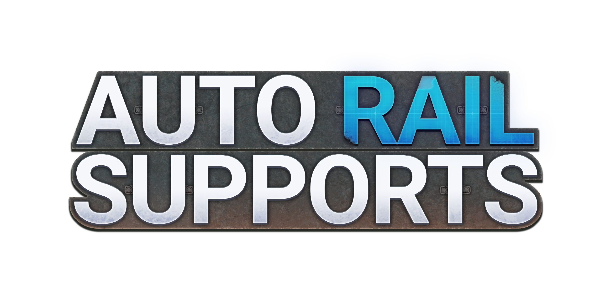

<section>
    

        

        
        
        
        
        
        
        
        
        

    

</section>

<section>
    <table>
        <thead>
            <tr>
                <th>Automatic supports</th>
                <th>Up to four pillar slots</th>
                <th>Apply to existing rails</th>
            </tr>
        </thead>
        <tbody>
            <tr>
                <td>
Tiled along the track spline, following curves and inclines.
</td>
                <td>
Each places a different blueprint every N segments.
</td>
                <td>
Apply supports to tracks you’ve already built.
</td>
            </tr>
        </tbody>
    </table>
</section>

<section>
<h2>Installation</h2>
<h3>Use the Mod Manager</h3>

Install Auto Rail Supports through the <b><a href="https://ficsit.app/">Satisfactory Mod Manager</a></b>

<ul>
    <li>Install the Mod Manager if you don't have it.</li>
    <li>Search for <b>Auto Rail Supports</b>.</li>
    <li>Click Install.</li>
    <li>Launch the game from the Mod Manager.</li>
</ul>

<b>Requires:</b> SML <b>3.12.0</b> or newer.

<h3>Multiplayer</h3>

Auto Rail Supports must be installed by <b>both the host and every client</b>.

<h3>Dedicated Servers</h3>

The mod builds for Windows and Linux dedicated servers as well as the game client. Install it on
the server through the Mod Manager's server management.

</section>

<section>
    <h2> How To Use </h2>
    <ul>
        <li>Design your supports in the Blueprint Designer and save them. Nothing needs to be unlocked beyond the Designer itself.</li>
        <li>Open the config menu with <b><i>U</i></b> (or type <i><b>/ars</b></i> in chat).</li>
        <li>Pick your blueprint for the Under-Rail slot, and optionally one or more Pillar slots.</li>
        <li>Build a railway. Supports appear underneath as you go.</li>
    </ul>
    
To add supports to existing rails: aim at the track with the dismantle gun and press <b><i>K</i></b> to enter ARS Adjustments, then click <b><i>LMB</i></b>.

    <h2>Controls & Settings</h2>
    
The default configurations might not be suitable for your blueprints. To adjust the blueprints positions and orientations, either open the config menu again and modify the settings or use the in-world ARS Adjustments mode in the build/dismantle gun.

    
You can find all the configurations, settings and keybinds in the mods <a href="https://itsalxx-sudo.github.io/AutoRailSupports/">Documentation</a>.

</section>

<section>
    <h2>Be Cautious</h2>
    
You can easily place a huge number of building parts with this mod. This can cause noticeable lag or even crashes. Be aware of your blueprints part count and the length of your railways.

    <h2>Reporting Bugs</h2>
    
Please open an issue on the <a href="https://github.com/itsalxx-sudo/AutoRailSupports/issues" target="_blank">GitHub issue tracker</a>.

</section>

<section>
    <h2>Contributing</h2>
    
Contributions are welcome.

    
See <a href="https://github.com/itsalxx-sudo/AutoRailSupports/blob/main/CONTRIBUTING.md">CONTRIBUTING.md</a> for more information.

</section>

<section>
    <h2>AI Disclosure</h2>
    
See <a href="https://github.com/itsalxx-sudo/AutoRailSupports/blob/main/AI_DISCLOSURE.md">AI_DISCLOSURE.md</a>.

</section>

<section>
    <h2>License</h2>
    

    Auto Rail Supports is licensed under the <b><a href="https://github.com/itsalxx-sudo/AutoRailSupports/blob/main/LICENSE">GNU General Public License v3.0</a></b>.
      
    You are free to use, study, modify, and redistribute this mod. If you distribute a modified
    version, it must also be released under the GPL-3.0 with its source available, and must retain
    attribution to the original author.
      
    Reuploading this mod elsewhere, modified or not, with the attribution stripped is a licence
    violation. If you'd like to build on Auto Rail Supports, fork it openly and keep the credit intact,
    that's all the licence asks.
    

</section>

<section>
    <h2>Support Me</h2>
    
If you enjoy this mod and want to support my work, donations are appreciated but never expected.

    
</section>

